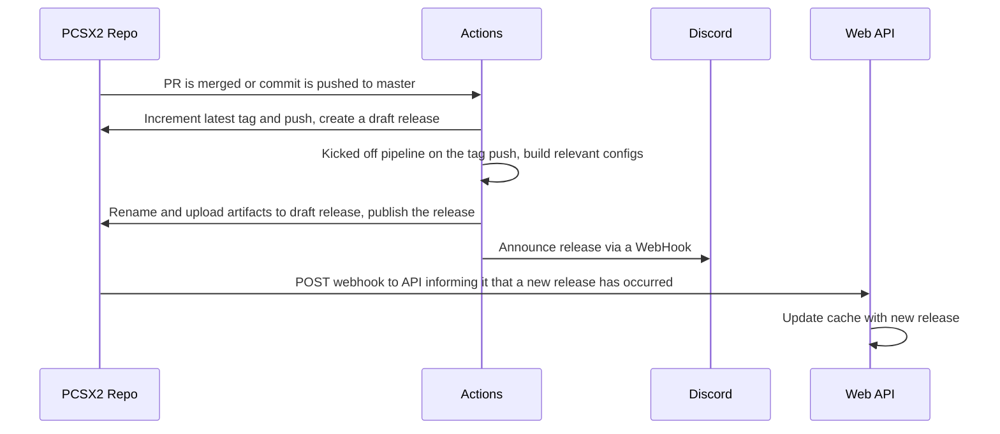

> This documentation is distributed with [Romlin’s parallel-ps2 fork](https://github.com/romlin-emu/parallel-ps2), derived from [libretro/parallel-ps2](https://github.com/libretro/parallel-ps2). Original project names, authors, and licenses are retained.

# CI Documentation

## Releases

